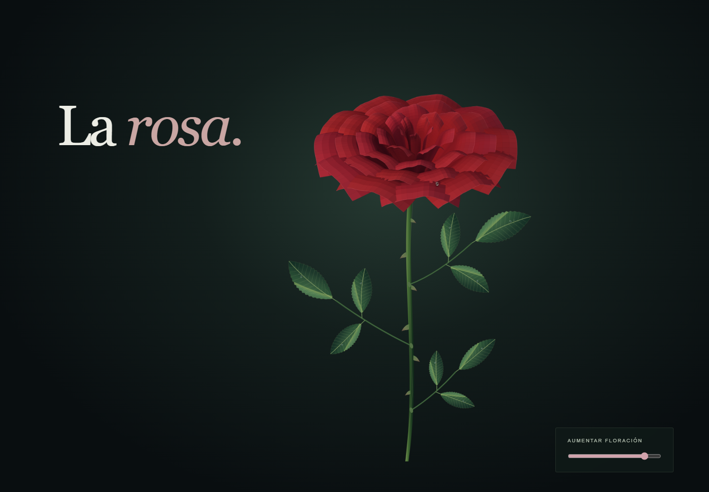

# La rosa

Una rosa animada hecha con HTML, CSS y JavaScript. La flor, el tallo y las hojas se dibujan en un canvas; la planta se mece suavemente y el control permite ajustar la floración.

## Captura

## Cómo abrirla

Abre `index.html` en un navegador moderno. No requiere instalación ni dependencias externas.

## Tecnologías

- HTML
- CSS
- JavaScript y Canvas 2D
